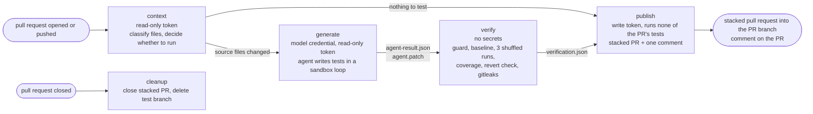
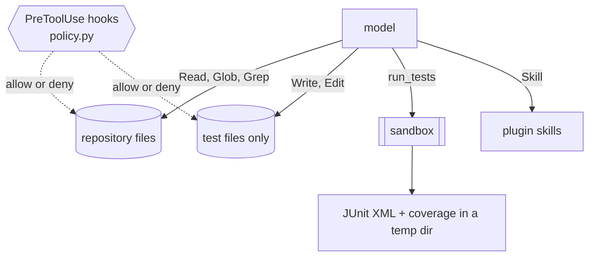
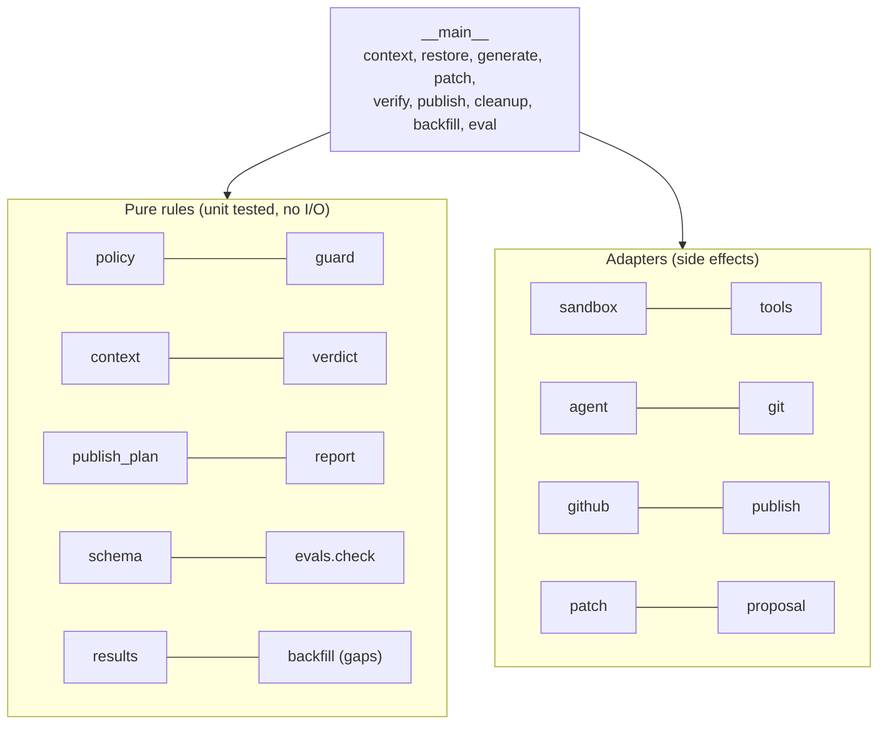

# Architecture

How a pull request becomes a verified proposal of unit tests. Everything lives in `.github/test-agent/`
(agent and skills in `plugin/`, the Python runner in `runner/`, evaluation scenarios in `evals/`) and
`.github/workflows/test-agent.yml`.

## Job flow

| Job | Holds | Never does |
|---|---|---|
| `context` | read token | run the model or any tests |
| `generate` | model credential (only in the agent step), read token | write to GitHub, run tests outside the sandbox |
| `verify` | read token | see the model credential, call the model |
| `publish`, `cleanup` | write token | run the pull request's tests or the model |

The jobs exchange files as artifacts: `context.json`, `agent-result.json`, `agent.patch`, `verification.json`.

## What the agent can do

There is no shell, no web access and no git for the model. The hooks run before every file tool call and deny
anything outside `policy.py`: writes are limited to `backend/tests/**/test_*.py`, empty `__init__.py` files and
`frontend/src/**/*.test.ts(x)`; reads exclude `.env*`, `.git/` and the evaluation scenarios.

## Runner modules

`verify` combines both: it takes the runner, the secret scanner and the coverage tool as arguments, so its
decisions are tested with scripted results.

## One piece of data, end to end

1. `context.json`: changed files with stack and kind (source, test, support, other), the capped diff of source
   files, the pull request title and body, the head commit.
2. `agent-result.json`: the structured answer of the agent (a decision per changed source file, findings) plus facts
   collected from the event stream: skills invoked, turns, cost, denied tool calls.
3. `agent.patch`: the diff of new and modified writable test files, produced in a step that has no credential.
4. `verification.json`: the verdict and every number shown in the comment.
5. The comment and the stacked pull request are rendered from 1 to 4. Numbers are never taken from the agent's answer.
